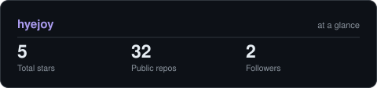

 

<!-- NAME / TAGLINE - animated typing -->

 

<!-- SOCIALS -->

&nbsp;&nbsp;

 

---

## This is me 🌿

안녕하세요, 복잡한 업무 데이터를 직관적인 UI로 만드는 개발자 **최혜조**입니다. 
React · Next.js · TypeScript를 중심으로 금융·ERP·산업 운영 시스템을 개발하며,
업무 흐름을 이해하고 데이터와 사용자 사이를 연결하는 화면을 만듭니다.

- **금융·산업 도메인 경험** — 은행 인증·로그인, 보험 업무, 부동산 금융 ERP부터 수급 스케줄링과 IoT 관제까지 다양한 업무 시스템을 개발했습니다.
- **데이터 시각화와 실시간 UI** — 차트·지도·그리드·SVG를 활용해 복잡한 운영 데이터를 읽기 쉬운 화면으로 구성합니다.
- **데이터 흐름을 따라가는 문제 해결** — API 연계, Spring Boot 로그 분석, SQL 조회를 통해 프론트엔드와 백엔드를 함께 살펴봅니다.
- **현재** — KB국민은행 코어뱅킹 현대화 프로젝트에서 개인뱅킹 로그인·회원가입 업무 분석과 Next.js 기반 선도개발에 참여하고 있습니다. _(2026.08 ~)_

## Tech stack

<b>Tech Details</b>

 

| 영역                    | 사용 기술                                                                |
| :---------------------- | :----------------------------------------------------------------------- |
| Frontend                | React, Next.js App Router, TypeScript, JavaScript, Vue.js                |
| State & Data            | Zustand, Redux Toolkit, TanStack Query (React Query), React Hook Form    |
| UI & Visualization      | Tailwind CSS, styled-components, Chart.js, Leaflet, Google Maps API, SVG |
| Realtime & Web          | WebSocket, MQTT, PWA, REST API                                           |
| Backend & Database 경험 | Java, Spring Boot, Oracle DB, SQL, SAP BO/BW, HANA SQL                   |
| Collaboration           | Git, GitLab, 브랜치 관리 및 배포                                         |

---

## Signals

<table>
<tr>
<td width="50%" align="center" valign="middle">

<!-- Self-rated skill radar - edit assets/skills.json, scripts/radar.py --data assets/skills.json -o assets/radar -->
<picture>
  <source media="(prefers-color-scheme: dark)"  srcset="assets/radar-dark.svg">
  <source media="(prefers-color-scheme: light)" srcset="assets/radar-light.svg">
  
</picture>

</td>
<td width="50%" align="center" valign="middle">

<!-- Live language mix from the GitHub API - scripts/radar.py --github hyejoy -o assets/radar-langs -->
<picture>
  <source media="(prefers-color-scheme: dark)"  srcset="assets/radar-langs-dark.svg">
  <source media="(prefers-color-scheme: light)" srcset="assets/radar-langs-light.svg">
  
</picture>

</td>
</tr>
</table>

---

## Numbers

<!-- Generated by scripts/cards.py into this repo: python scripts/cards.py --user hyejoy --out assets -->
<picture>
  <source media="(prefers-color-scheme: dark)"  srcset="assets/card-stats-dark.svg">
  <source media="(prefers-color-scheme: light)" srcset="assets/card-stats-light.svg">
  
</picture>

---

## Selected projects

### DevTime · 개발 학습 타이머

**학습 기록을 시각화하는 타이머 웹 애플리케이션** · 개인 프로젝트 · 2026.01 ~ 2026.02

- 연간 학습 히트맵과 요일별 평균 학습 시간 Bar 차트 설계·구현
- 누적 학습 시간, 학습 일수, 목표 달성률을 통계 대시보드로 구성
- 날짜 변경과 일시정지를 고려한 일자별 타이머 분리 로직 구현

`Next.js` `TypeScript` `Zustand` `Tailwind CSS` `JWT`

[서비스 보기 →](https://devtime-chi.vercel.app)

### Geospatial Data Analysis Platform · 지리공간 분석

**위성 데이터 기반 분석 결과를 시각화하는 플랫폼 프로토타입** · 개인 프로젝트 · 2026.02 ~ 2026.03

- Leaflet 지도 위 관심 영역(ROI) 설정 및 분석 인터페이스 구현
- NDVI 시계열 라인 차트와 SAR 위성 데이터 시각화 UI 구성
- 공간 데이터의 레이어 관리와 ROI 설정 → 분석 → 결과 확인 흐름 설계

`Next.js` `TypeScript` `Zustand` `Tailwind CSS` `Leaflet`

[서비스 보기 →](https://stellargeo.vercel.app/analysis)

## Work highlights

| 프로젝트                                                     | 기여                                                                                                                        |
| :----------------------------------------------------------- | :-------------------------------------------------------------------------------------------------------------------------- |
| **KB국민은행 · 코어뱅킹 현대화** 2026.08 ~ 현재           | 개인뱅킹 인증·회원가입 AS-IS 분석, Next.js 로그인·API Proxy Route 개발, 토큰 발급 및 로그인 API 연계                        |
| **코람코자산신탁·운용 · RFIS ERP** 2026.04 ~ 2026.06      | 시장딜 중복 소재지 검증, 위원회 관리 UX 개선, Spring Boot·Oracle 기반 오류 분석, 신탁·운용 GitLab 브랜치 관리 및 배포       |
| **SCREEN SPE KOREA · 장비 운영 시스템** 2024.12 ~ 2025.02 | 데이터 구조 분석을 통한 Chart.js 대시보드 제안·구현, 4Depth 메뉴와 변경 이력 공통 기능 개발                                 |
| **한국수력원자력 · ERP 고도화** 2023.05 ~ 2024.09         | SAP BO/BW 기반 운영 데이터 분석·시각화, 데이터 모델 설계부터 화면 개발·운영까지 수행                                        |
| **GS칼텍스 · 수급 OS 고도화** 2022.08 ~ 2023.04           | Drag & Drop 수급 스케줄 UI, 업무 조건 유효성 피드백, 보고용 Excel 다운로드 구현                                             |
| **Rinnai · CASCADE / IoT 모니터링** 2022.01 ~ 2022.07     | 지도·SVG 기반 장비 상태 시각화, WebSocket·MQTT 실시간 UI, 모바일 PWA 구축. 제안한 Carousel 모니터링 UI가 공식 기능으로 채택 |
| **MetLife · 차세대 프로젝트** 2021.05 ~ 2021.10           | React 고객 설문·보험 대출 신청 화면, 휴대폰 인증·MFA UI, 백엔드 API 연계 구현                                               |

---

`Built with love · hye_jo@kakao.com`

